# LM Gestão — Controle de despesas de veículos com n8n

Sistema web para organizar os custos dos veículos da **LM Veículos** e avisar automaticamente quando as despesas atingem o limite configurado, usando **n8n e Gmail**.

**Autor:** Wesley Solisnande Santos Zorzolli  
**Disciplina:** Automação e Programabilidade em Redes — Prof. Wagner Loch, UniSenac

## 1. Sobre o projeto e o problema resolvido

Uma revenda registra gastos com manutenção, peças, combustível, serviços e divulgação em momentos diferentes. Sem controle centralizado, é difícil identificar quando os custos adicionais de determinado veículo ultrapassam o orçamento.

O **LM Gestão** registra os veículos e suas despesas, calcula os totais e dispara um alerta por e-mail quando o limite é atingido. Isso reduz a necessidade de conferência manual constante e aumenta a visibilidade dos custos.

**Funcionalidades:**

- Login privado por e-mail e senha.
- Cadastro de veículos com foto, placa, ano e preço de compra.
- Lançamento de despesas por categoria, valor, data e comprovante opcional.
- Histórico, busca, totais por veículo e controle de venda com resultado estimado.
- Alerta visual e integração com o n8n ao atingir o limite de despesas (padrão: **R$ 3.000,00**).
- E-mail de alerta enviado pelo Gmail via OAuth2 no n8n.

O sistema apoia o controle operacional e não substitui uma solução contábil ou fiscal.

## 2. Arquitetura e fluxo de funcionamento

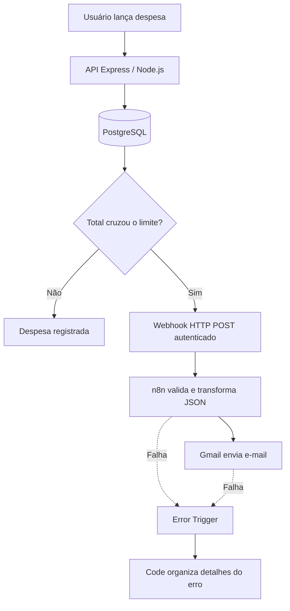

Quando uma despesa faz o acumulado passar de um valor **abaixo** do limite para um valor **igual ou acima**, a API envia ao n8n um evento JSON semelhante a este:

```json
{
  "event": "vehicle_expense_limit_reached",
  "vehicle_id": "id-do-veiculo",
  "vehicle_name": "Veículo de teste",
  "total_expenses_cents": 300001,
  "limit_cents": 300000,
  "occurred_at": "2026-11-09T18:00:00.000Z"
}
```

Os valores são representados em **centavos**. Um nó Code (JavaScript) do n8n valida o tipo do evento, os campos obrigatórios e os valores numéricos; em seguida, formata os montantes em reais (`pt-BR`) e prepara o assunto e o corpo do e-mail.

**Importante:** o alerta é disparado quando o total cruza o limite de baixo para cima, não em toda despesa posterior. O preço de compra não entra no limite das despesas adicionais.

### Tratamento de erros

- O backend espera no máximo **5 segundos** pela resposta do webhook.
- Respostas HTTP de erro são registradas nos logs do aplicativo. A resposta imediata do webhook confirma o recebimento da requisição, não a entrega do e-mail.
- Se o n8n não responder, a despesa permanece salva no banco.
- O workflow principal está vinculado a outro fluxo com **Error Trigger → Registrar detalhes do erro**.
- Um teste controlado provocou falha em um workflow separado; o Error Trigger executou com sucesso e registrou os detalhes.

**Limitação:** ainda não existe fila persistente ou reenvio automático quando o n8n está indisponível. Uma tentativa perdida pode exigir recuperação manual.

## 3. Tecnologias, APIs e protocolos

| Tecnologia | Utilização |
| --- | --- |
| React, TypeScript e Vite | Interface web |
| Node.js e Express | API REST e regras de negócio |
| PostgreSQL 16 | Persistência dos dados |
| n8n | Recebimento, validação e roteamento dos eventos |
| Gmail API com OAuth2 | Envio dos alertas |
| Docker e Docker Compose | Execução local dos serviços |
| HTTP, JSON, Bearer Token | Comunicação e autenticação entre os serviços |

## 4. Pré-requisitos e como executar

### Preparação

É necessário ter **Docker Desktop** e, para o envio de e-mails, uma conta Google autorizada no n8n. O Git é opcional caso o código seja obtido por ZIP.

```powershell
git clone https://github.com/wesley-zorzolli/LM-Gestao.git
cd LM-Gestao
Copy-Item .env.example .env
```

Edite **localmente** o `.env` com os seguintes valores:

| Variável | Finalidade |
| --- | --- |
| `POSTGRES_PASSWORD` | Senha privada do banco |
| `SESSION_SECRET` | Chave aleatória de sessão (mínimo 32 caracteres) |
| `ADMIN1_EMAIL` / `ADMIN1_PASSWORD` | Credenciais iniciais de administrador (senha com pelo menos 12 caracteres) |
| `APP_PORT` | Porta local, normalmente `3001` |
| `ALERT_EXPENSE_LIMIT_CENTS` | Limite em centavos; `300000` = R$ 3.000,00 |
| `AUTOMATION_TOKEN` | Token exclusivo de integração (mínimo 32 caracteres) |
| `N8N_ALERT_WEBHOOK_URL` | URL interna do webhook do n8n |

**Nunca publique o `.env` ou credenciais reais.** O arquivo `.env.example` usa somente valores de exemplo. A senha de uma conta já existente não é alterada automaticamente ao modificar `ADMIN1_PASSWORD`.

Suba aplicação, banco e n8n:

```powershell
docker compose --profile automation up -d --build
```

- Painel LM Gestão: http://localhost:3001
- n8n: http://localhost:5678

### Configuração do n8n

1. Importe `n8n/03-tratamento-erros.json` e `n8n/01-alerta-despesas.json`. O **workflow de alerta** conta com os nós **Webhook → Validar e preparar alerta → Enviar alerta pelo Gmail**.
2. No Webhook, selecione método `POST`, caminho `lm-custos` e **Header Auth**.
3. Crie a credencial `Header Auth` com `Name = Authorization` e `Value = Bearer ` seguido do valor de `AUTOMATION_TOKEN` (com um espaço entre `Bearer` e o token). Selecione essa credencial no Webhook.
4. Configure a credencial OAuth2 do Gmail e o endereço destinatário no nó de envio.
5. Salve o workflow de tratamento de erros e associe-o ao fluxo principal em **Settings → Error Workflow**. Salve e publique o workflow de alertas.
6. No `.env` do aplicativo, defina:

   ```env
   N8N_ALERT_WEBHOOK_URL=http://n8n:5678/webhook/lm-custos
   ```

7. Recrie somente o aplicativo para carregar a configuração:

   ```powershell
   docker compose up -d --no-deps --force-recreate app
   ```

8. Verifique se o workflow **LM Gestão - Tratamento de Erros** está disponível e associado ao fluxo principal.

**Nota para o repositório:** os dois workflows exportados estão na pasta `n8n/`, sem as credenciais reais. Após a importação, configure as credenciais, o destinatário e a associação ao workflow de erros no seu ambiente. O relatório semanal permanece como melhoria futura.

### Comandos úteis

```powershell
docker compose --profile automation ps
docker compose logs --tail=100 app
docker compose --profile automation down
```

`docker compose down` para os serviços sem remover os volumes. **Não use `docker compose down -v`** sem compreender o risco de perda de dados.

## 5. Demonstração e resultados

**Teste do alerta:** ao ultrapassar R$ 3.000,00 em despesas de um veículo, a API enviou JSON ao n8n, que processou os dados e entregou um e-mail formatado pelo Gmail. O teste foi repetido após a reconexão da credencial do Gmail e o e-mail chegou corretamente.

**Teste de erro:** um workflow temporário **Webhook → Simular erro** falhou intencionalmente; o workflow **Error Trigger → Registrar detalhes do erro** foi acionado e executou com sucesso. O workflow temporário foi despublicado depois do teste.

### Capturas de tela

As onze capturas a seguir apresentam a interface, a automação principal e os testes de tratamento de erros. As placas cadastradas exibidas nas telas de exemplo estão mascaradas.

#### 1. Tela de acesso

Login privado do LM Gestão, com autenticação por e-mail e senha.

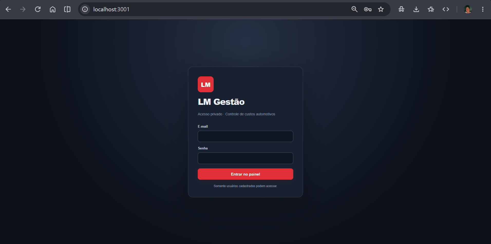

#### 2. Painel de veículos

Visão geral dos veículos cadastrados, quantidade em estoque e valores investidos.

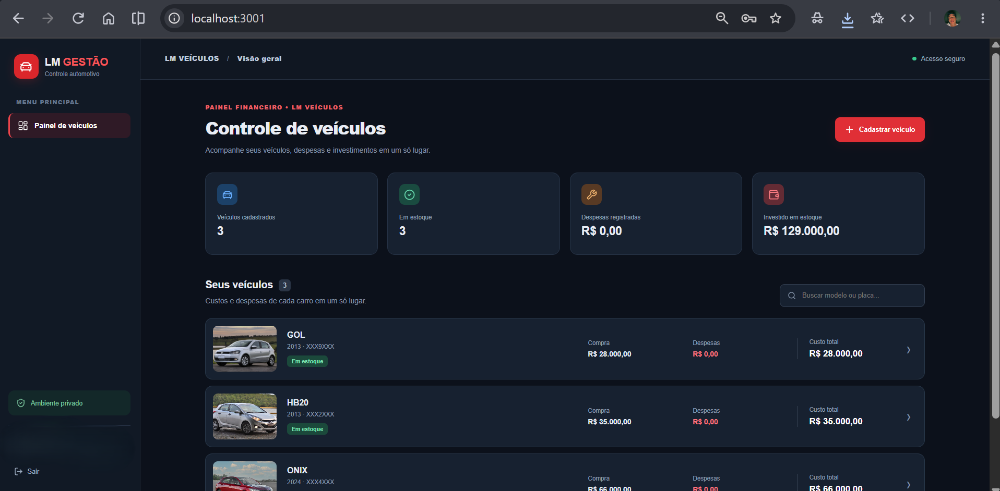

#### 3. Cadastro de veículo

Formulário para registrar modelo, ano, placa, valor de compra e imagem opcional.

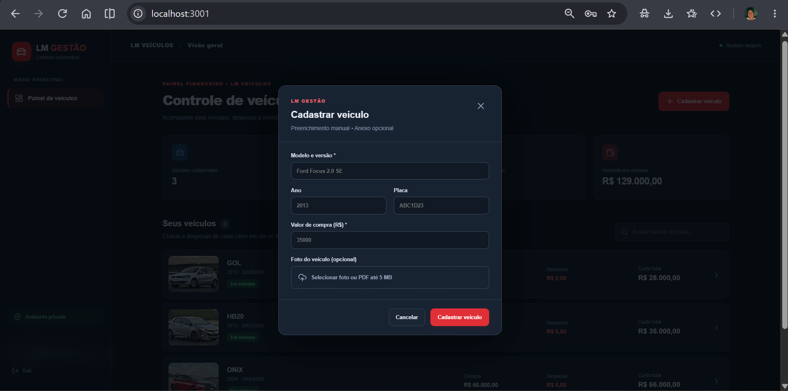

#### 4. Detalhes de um veículo

Ficha com imagem, valores de compra, despesas adicionais, investimento total e histórico.

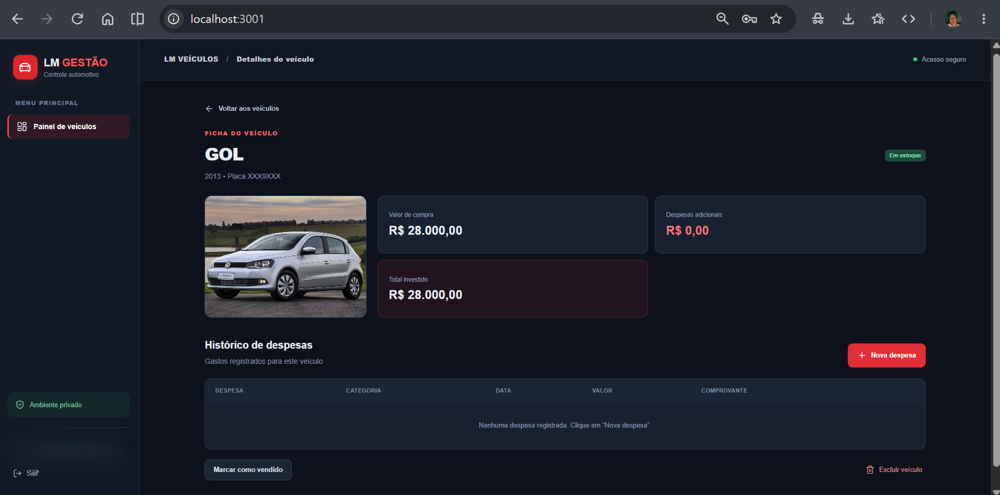

#### 5. Cadastro de despesa

Registro manual de categoria, descrição, valor, data e comprovante opcional.

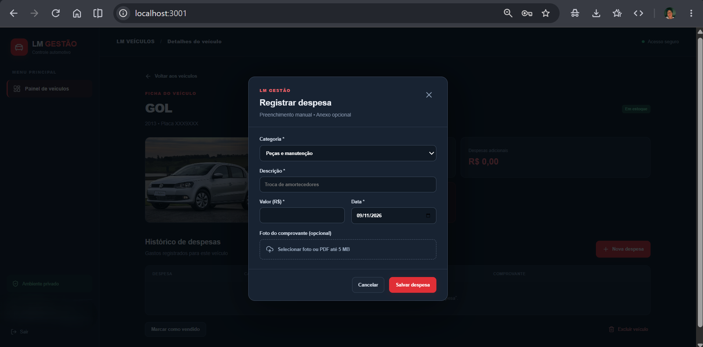

#### 6. Despesas registradas

Histórico com a despesa adicionada e os valores recalculados no painel do veículo.

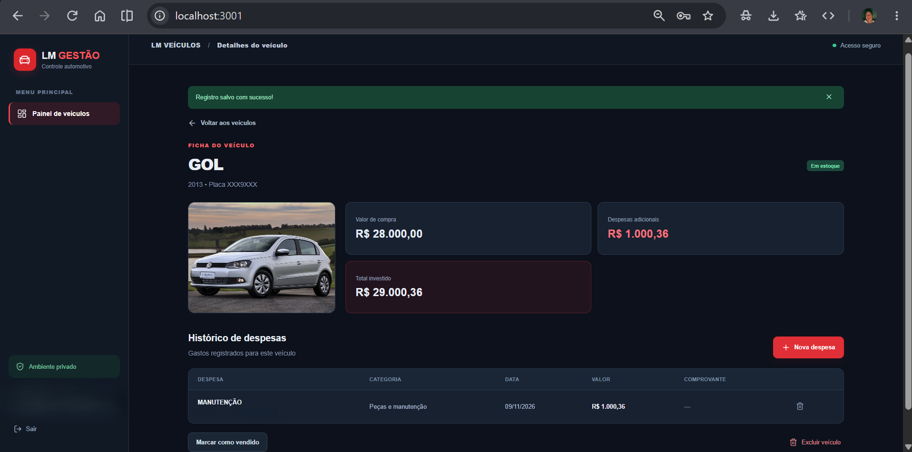

#### 7. Automação no n8n

Workflow publicado que recebe o evento pelo Webhook, valida e prepara os dados no nó Code e envia a mensagem pelo Gmail.

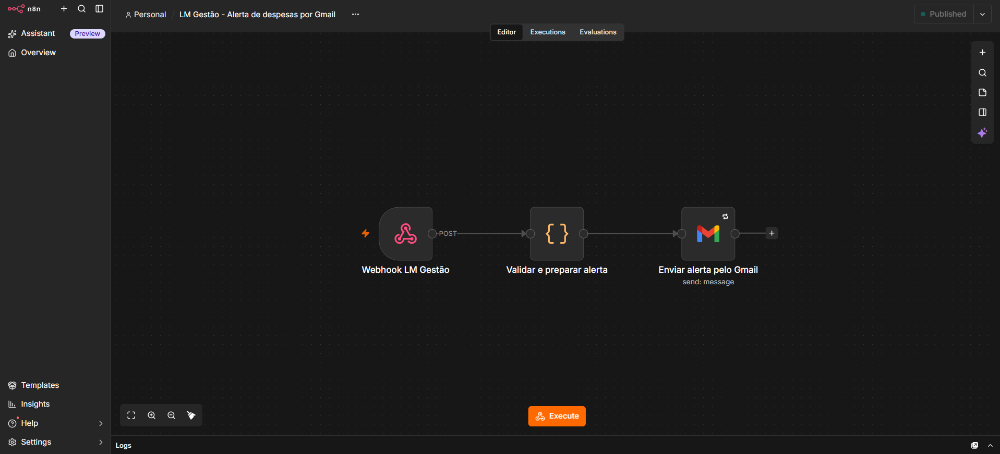

#### 8. Alerta recebido por e-mail

Mensagem automática demonstrando o limite de **R$ 3.000,00** atingido pelo veículo e o total de despesas informado.

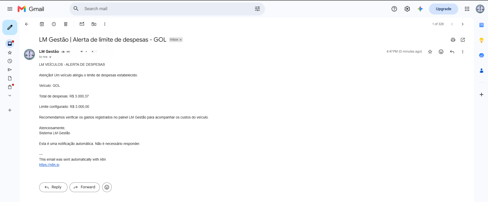


#### 9. Workflow de tratamento de erros

Fluxo composto pelo Error Trigger e pelo nó Code, responsável por organizar o nome do workflow, o nó que falhou, a mensagem de erro e a data da ocorrência.

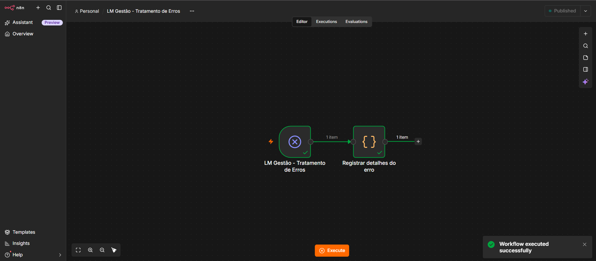

#### 10. Teste de falha proposital

Em 09/11/2026, às 14:48:20, um workflow separado recebeu uma requisição GET e gerou uma falha intencional no nó Simular erro. A execução foi registrada com status Error.

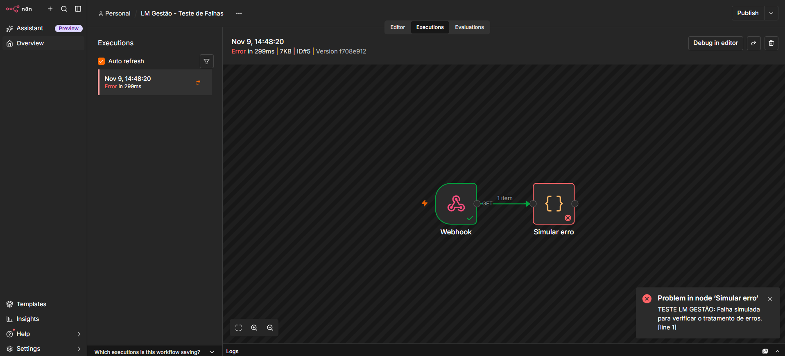

#### 11. Resultado do tratamento de erros

O histórico do workflow de tratamento de erros mostra uma execução bem-sucedida em 09/11/2026, às 14:48:20, no mesmo horário do teste de falha. A execução selecionada na captura, de 16/11/2026, também apresenta os dois nós concluídos com sucesso.

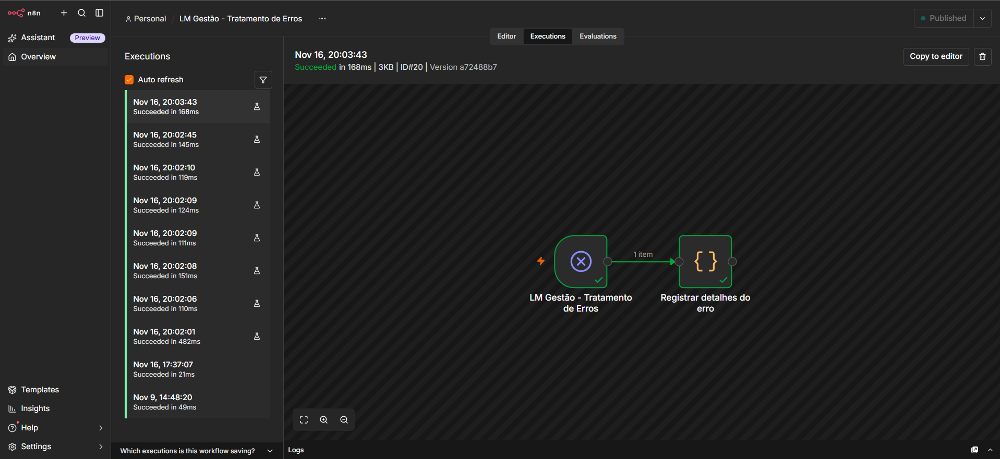

## 6. Segurança e privacidade

- Senhas armazenadas em **hash bcrypt**.
- Sessões em cookies `HttpOnly`, `SameSite=Strict`, com validade de 12 horas.
- Limite de tentativas no login e rotas de dados protegidas por autenticação.
- PostgreSQL sem porta pública no host e aplicativo/n8n expostos apenas em `127.0.0.1` na configuração local.
- Integração por **Bearer Token** e envio Gmail com credencial **OAuth2** gerenciada pelo n8n.
- Variáveis privadas no `.env`, excluído do versionamento; `.dockerignore` exclui credenciais e arquivos locais do contexto de build.
- Backup do PostgreSQL realizado com `pg_dump` e conferência do conteúdo com `pg_restore -l`. A restauração completa ainda não foi testada. Backups e anexos privados devem ficar fora do GitHub.

Esta instalação é **local**, não um serviço público com HTTPS. Uma implantação futura exigirá HTTPS, política de backups e revisão de segurança apropriada.

## 7. Melhorias futuras (roadmap)

1. **Fila de alertas e reenvio automático** para falhas temporárias de rede.
2. **Relatórios semanais** por e-mail e exportação de despesas.
3. **Acesso remoto seguro** com HTTPS, backups automatizados e múltiplos usuários.

---

**Status:** aplicação, integração n8n/Gmail, alerta por e-mail e tratamento de erros testados em ambiente local. Os workflows exportados acompanham o código-fonte.
